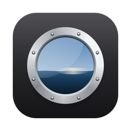

<p align="center">
  
</p>

<h1 align="center">Hullport</h1>

<p align="center">
  A Docker manager for macOS that runs its own engine.<br>
  Containers, images, volumes, builds and networks, plus a Linux VM you can read end to end.
</p>

---

Hullport is a desktop app for Apple Silicon Macs. It gives you a fast native-feeling interface for everyday Docker
work, and it brings its own engine: a small Linux virtual machine with Docker Engine inside, built from open-source
parts that are pinned, checksummed and patched in this repository. The menu bar icon starts and stops that VM, and
your terminal's `docker` can point at it.

It exists for three reasons: to run Docker on a Mac without paying for or depending on a closed product, to know
exactly what runs on the machine, and to learn how a Docker engine on macOS works from the inside.

## Contents

- [Features](#features)
- [Requirements](#requirements)
- [Install](#install)
- [Using Hullport](#using-hullport)
- [How it works](#how-it-works)
- [Development](#development)
- [Status and limitations](#status-and-limitations)
- [Credits](#credits)
- [License](#license)

## Features

| Area | What you can do |
|---|---|
| **Containers** | Start, stop, pause, restart and delete; group by Compose project; logs with search; an interactive terminal; live CPU, memory and network stats; full inspect |
| **Images** | Pull with progress, tag, run, delete; see layers, environment and which containers use each image |
| **Volumes** | Browse files read-only, export to a tar archive, see size and which containers mount them |
| **Builds** | Run BuildKit builds and watch the real step graph; history, failed steps, rebuild and cancel |
| **Networks** | Create, inspect, connect and disconnect containers |
| **Engine** | Hullport's own VM (Lima + Docker Engine) from the menu bar; start at login; connect to OrbStack, Docker Desktop or Colima instead if you prefer |
| **Moving in** | Copy images, volumes and containers over from OrbStack; switch the terminal's `docker` to Hullport, with one-click undo |

Changes you make with the `docker` CLI show up live: the app follows Docker's event stream instead of polling.
Every destructive action asks first.

## Requirements

- A Mac with **Apple Silicon** (M1 or later). Intel Macs aren't supported.
- **macOS 13 Ventura or later**, which Lima needs for Apple's Virtualization framework. Developed on macOS 15.
- Free disk for your images and volumes. Docker's data lives on a separate sparse disk that grows as needed,
  up to 60 GiB.
- To build: [Rust](https://rustup.rs) (stable), [Node.js](https://nodejs.org) 20+, [Go](https://go.dev) 1.26.8+,
  and the Xcode Command Line Tools (`xcode-select --install`).

There are no prebuilt downloads yet. Hullport is built from source on your Mac, which also means macOS never
quarantines it, so it opens without Gatekeeper prompts even though it isn't notarized.

## Install

```sh
git clone https://github.com/nicolasleal570/hullport.git
cd hullport

# 1. The engine (once): downloads the pinned pieces, builds Lima with its patches,
#    installs everything under ~/.hullport and boots the VM. The first boot takes a few minutes.
scripts/engine.sh install
scripts/engine.sh start

# 2. The app
npm install
npm run tauri build
ditto target/release/bundle/macos/Hullport.app /Applications/Hullport.app
```

Open **Hullport** from Applications. It adopts the VM you just started, and from then on the app starts and stops
it: the VM runs while the menu bar icon is there, and **Quit** shuts it down cleanly.

Everything Hullport installs lives in `~/.hullport`. It never writes to `~/.docker`, OrbStack's files or Docker
Desktop's files.

## Using Hullport

### The menu bar icon

The porthole in the menu bar shows the engine's state and lets you start or stop it, open the window, turn on
**Open at Login**, or quit. Closing the window doesn't stop anything; quitting stops the VM first and shows you
the progress while it does.

### Point your terminal at Hullport

For one terminal session:

```sh
eval "$(scripts/engine.sh env)"
docker ps
```

To make it permanent, open **Engines → Terminal** in the app. Hullport shows every change it will make (the
`/var/run/docker.sock` link, the `docker` and Compose binaries, the CLI context), applies them after one admin
password prompt, and records them so **Undo** puts everything back exactly as it was.

### Coming from OrbStack

In **Engines**, click **Migrate to Hullport…** on the OrbStack row. Hullport reads OrbStack without changing it
and lists what it can copy: tagged images, named volumes with their data, and containers that aren't part of a
Compose project, which it recreates from their settings. Pick what you want, and Hullport copies it into its own
engine. OrbStack keeps all its data.

Compose containers aren't copied: once the images and volumes are in, run `docker compose up` in the project's
folder and Compose recreates them on Hullport.

### Keyboard

| Keys | Action |
|---|---|
| `⌘1`–`⌘5` | Switch sections |
| `⌘F` | Search |
| `⌘N` | New container, pull, volume, build or network |
| `⌘R` | Refresh |
| `↑` / `↓` | Move through a list |
| `Return` | Open logs (containers), Run (images), files (volumes) |
| `⌘⌫` | Delete (always asks) |

Right-click any row for its full menu.

## How it works

```
Hullport.app (Tauri: Rust + React)
 ├─ menu bar icon ── owns ──► limactl (host agent) ──► Linux VM (Apple Virtualization framework)
 │                                                       └─ Ubuntu + Docker Engine
 │                                                          └─ /var/lib/docker on its own data disk
 └─ Docker Engine API ◄── ~/.hullport/run/docker.sock ◄── forwarded from the VM
```

The engine is a set of pinned pieces, each with its version and checksum in
[`engine/versions.toml`](engine/versions.toml):

| Piece | Version | Notes |
|---|---|---|
| [Lima](https://github.com/lima-vm/lima) | 2.3.0 | Built from source with the patches in [`engine/patches/lima`](engine/patches/lima) |
| [gvisor-tap-vsock](https://github.com/containers/gvisor-tap-vsock) | 0.9.0 | VM networking and DNS, patched to forward DNS answers over 512 bytes |
| Ubuntu cloud image | 26.04 | arm64, pinned by checksum |
| Docker Engine | 29.10.0 | Installed in the VM from Docker's apt repository |
| `docker` CLI, Compose, Buildx | 29.10.0 / 5.8.0 / 0.39.1 | macOS arm64 binaries, installed under `~/.hullport` |

The Lima patches fix two things that bite real projects:

- **Ports:** Lima won't take a localhost port that another Mac process already holds, so a local Postgres and a
  container publishing 5432 don't silently shadow each other.
- **File watching:** renames inside mounted folders reach the VM, so file watchers in containers notice them
  (many editors save a file by writing a copy and renaming it).

The VM config in [`engine/hullport.yaml`](engine/hullport.yaml) also makes the Docker socket path bind-mountable
inside the VM, which tools like `supabase start` rely on.

On the app side, all Docker access happens in Rust through [bollard](https://github.com/fussybeaver/bollard)
over the engine's socket; the interface never sees credentials. Logs, stats, pulls, builds and the terminal stream
over Tauri channels, and each one can be cancelled. Builds run `docker buildx build --progress=rawjson`, which is
how the app draws BuildKit's real step graph. Volume files are read through a short-lived `alpine` container that
mounts the volume read-only and is removed when you close the browser.

```
src/              Rust backend: engine lifecycle, menu bar, Docker commands per area, migration, terminal cutover
ui/src/           React + TypeScript + Tailwind interface, one folder per section in features/
engine/           VM config, pinned versions and patches
scripts/engine.sh fetch, build, install, start, stop, status, shell and env for the engine
```

## Development

```sh
npm install
npm run build        # type-check and bundle the interface into dist/
cargo build          # debug app at target/debug/hullport
cargo test           # unit tests; the ignored ones boot the real VM
```

`cargo build` works on its own once `dist/` exists, because the interface is embedded at compile time.

The app has check modes that run without a window and exit:

```sh
target/debug/hullport --screenshot shots/now.png --section images   # render a section to a PNG
target/debug/hullport --self-test shots/self-test.json              # walk every section
target/debug/hullport --verify shots/verify.json --fixtures "$PWD/tests/fixtures" --context hullport
```

`--verify` runs end-to-end checks against a real engine: container lifecycle, logs, exec with a terminal, stats,
pull and tag, volume browse and export, a BuildKit build and its cancel, network connect and disconnect, and
mounting the engine's own socket into a container. It only creates resources named `hullport-verify-*` and removes
them afterwards.

To work on the engine:

```sh
scripts/engine.sh status    # VM state and the Docker socket
scripts/engine.sh shell     # a shell inside the VM
scripts/engine.sh stop      # shut the VM down
```

## Status and limitations

Hullport is a personal project in active use, not a finished product. Things to know:

- Apple Silicon only, built from source, not signed with a Developer ID or notarized.
- The engine is installed with `scripts/engine.sh`; the app doesn't carry Lima inside its bundle yet.
- VM resources (4 CPUs, 8 GiB memory) are shown in the app but changed only in `engine/hullport.yaml`.
- `ssh://` and TLS `tcp://` Docker contexts aren't supported.
- No Files tab for containers yet.

## Credits

Hullport stands on open-source work: [Lima](https://github.com/lima-vm/lima),
[gvisor-tap-vsock](https://github.com/containers/gvisor-tap-vsock), [Docker](https://github.com/moby/moby),
[Tauri](https://tauri.app), [bollard](https://github.com/fussybeaver/bollard), [React](https://react.dev),
[TanStack Query](https://tanstack.com/query), [xterm.js](https://xtermjs.org) and
[Tailwind CSS](https://tailwindcss.com).

## License

Hullport is licensed under the [Apache License 2.0](LICENSE). The patches in `engine/patches` modify Lima and
gvisor-tap-vsock, which are also Apache-2.0.
